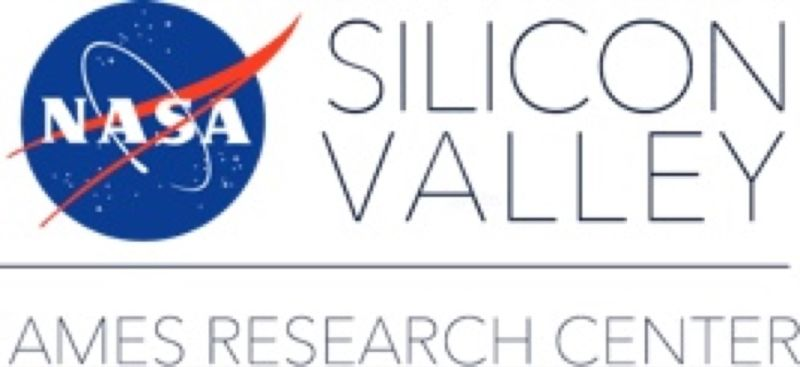
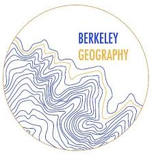

::: {.xp-item}

::: {.xp-body}
### Projects Data Coordinator

**National Center for Ecological Analysis & Synthesis, UC Santa Barbara**\
[Oct 2023 – Present · Santa Barbara, CA]{.xp-meta}

Curate and publish Arctic research data for the NSF [Arctic Data Center](https://arcticdata.io/) and process permafrost datasets for the [Permafrost Discovery Gateway](https://permafrost.arcticdata.io/).

-   Direct the archival, curation, and publishing of **340+ TB** of research data, from geospatial rasters & vectors to climate model output and survey data
-   Build open-source R & Python tools and run parallelized workflows on UCSB's HPC clusters
-   Mentor a team of **5+ interns** and teach **3 annual courses** on reproducible & scalable research ([Teaching](teaching.qmd))

[Related project: Pan-Arctic Permafrost Visualization →](research/permafrost-visualization/index.qmd){.xp-link}
:::
:::

::: {.xp-item}

::: {.xp-body}
### Research Data Scientist

**NASA Ames Research Center** (via KBR Inc.)\
[Aug 2021 – Mar 2023 · Mountain View, CA]{.xp-meta}

Built semantic search and question answering tools for mission documents in the Intelligent Systems Division, with Nija Shi and Guillaume Brat.

-   Search system used on **3 missions**, covering 2,000+ project documents
-   Improved correct retrieval by **30+%** by fine-tuning BERT models on NASA phrases & acronyms
-   Sped up document auditing by **3+ months**

[Related project: Semantic Search for NASA Mission Documents →](research/nasa-semantic-search/index.qmd){.xp-link}
:::
:::

::: {.xp-item}

::: {.xp-body}
### Research Assistant

**Environmental Systems Dynamics Lab, UC Berkeley** (advised by Laurel Larsen)\
[Aug 2020 – Aug 2021 · Berkeley, CA]{.xp-meta}

Developed physics-informed LSTM neural networks in PyTorch to forecast watershed discharge.

-   Improved model accuracy by **5%** by adding physics-based constraints
-   Tested robustness across **30 watershed datasets** in varying climates
-   Co-authored posters at the AGU Fall Meeting (2021, 2022)

[Related project: Physics-Informed LSTMs for Streamflow →](research/physics-informed-lstm/index.qmd){.xp-link}
:::
:::

::: {.xp-item}

::: {.xp-body}
### Data Science Intern

**ClimateAi**\
[Jun 2020 – Aug 2020 · San Francisco, CA]{.xp-meta}

Built a multi-model ensemble for short-term temperature and precipitation forecasts.

-   Improved forecasts by **20%** over the best vendor's model
-   Combined **6 data sources** across 30 customer locations & 4 lead times
-   Automated forecast pipelines in Google Cloud with Xarray & pandas

[Related project: Meta-Model Weather Forecasting →](research/weather-meta-model/index.qmd){.xp-link}
:::
:::

## Education

::: {.xp-item}

<i class="bi bi-mortarboard-fill"></i>

::: {.xp-body}
### B.A. Data Science, emphasis in Earth Science

**University of California, Berkeley**\
[2021]{.xp-meta}

Study abroad in Statistics & Mathematics at Lund University, Sweden.
:::
:::
