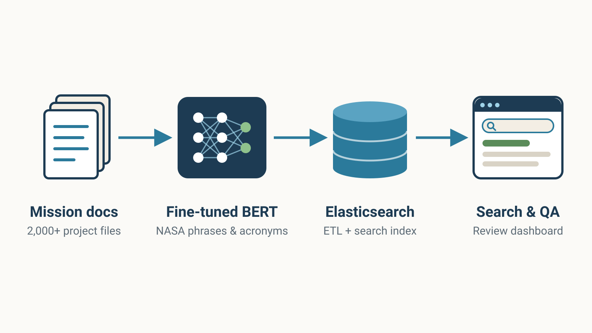

## Overview

NASA missions produce thousands of requirements documents, reports, and artifacts that reviewers must search through for evidence. In the Intelligent Systems Division at NASA Ames, working with Nija Shi and Guillaume Brat, I developed a semantic search and question answering system, built into a project management dashboard, to speed up this auditing process.

{fig-alt="Pipeline diagram: 2,000+ mission documents flow into fine-tuned BERT models, then an Elasticsearch index, then a search and question answering dashboard."}

## My Role

-   Built a semantic search system, used on **3 missions**, that analyzes **2,000+** project documents and retrieves critical evidence for reviews
-   Fine-tuned BERT transformer language models to better represent NASA-specific phrases & acronyms, improving correct retrieval by **30+%**
-   Added a question answering tool to the dashboard, expediting document auditing by **3+ months**
-   Designed ETL and search pipelines with Elasticsearch, connected to a NodeJS/React front end through the Haystack REST API

## Tools

Python · BERT / Transformers · Haystack · Elasticsearch · NodeJS · React

## Related Work

-   **Kadi, J.** *Enhanced Requirement Traceability Using Recurrent Neural Networks.* NASA Research Poster Symposium, 2019. Poster.
